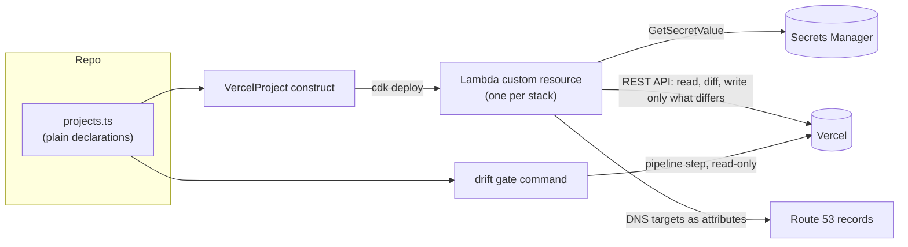

# cdk-vercel

[](https://github.com/indilago/cdk-vercel/actions/workflows/ci.yml)
[](https://www.npmjs.com/package/cdk-vercel)
[](LICENSE)

Manage Vercel projects from AWS CDK: build and Git settings, environment variables (with
values from AWS Secrets Manager), domains, Route 53 records and deployment protection.
It also includes a **drift gate** and a **fail-fast deployment waiter** for your pipeline.

```ts
import { VercelProject } from 'cdk-vercel';

new VercelProject(this, 'Web', {
  teamId: 'team_xxxxxxxx',
  projectId: 'prj_xxxxxxxx', // adopt an existing project
  expectRepo: 'acme/monorepo', // refuse to touch a project linked anywhere else
  tokenSecret: secretsmanager.Secret.fromSecretNameV2(this, 'Token', 'vercel/token'),
  settings: {
    rootDirectory: 'packages/web',
    framework: 'nextjs',
    nodeVersion: '24.x',
    productionBranch: 'production',
    enableAffectedProjectsDeployments: false,
  },
  env: [
    { key: 'NEXT_PUBLIC_API_URL', targets: ['production'], type: 'plain', value: 'https://api.acme.com' },
    {
      key: 'STRIPE_SECRET_KEY',
      targets: ['production'],
      type: 'sensitive',
      secret: { secretId: 'acme/prod/app', jsonKey: 'stripeKey' },
    },
  ],
  domains: [{ name: 'app.acme.com' }],
});
```

## Status

**Pre-release (0.x). It has not yet been run against the live Vercel API.** The test suite
runs against an in-memory fake built from response shapes in Vercel's
[OpenAPI spec](https://openapi.vercel.sh/). Every endpoint is checked against that spec except
one: the production-branch endpoint, which is undocumented (see [Settings](#settings)). Until
a release says otherwise:

- Start every project with `dryRun: true` and read what it would change (see [Getting started](#getting-started)).
- Expect breaking changes between minor versions.
- Please [open an issue](https://github.com/indilago/cdk-vercel/issues) with the request and response (redacted) when something doesn't match the real API.

## Contents

- [Why](#why)
- [How it works](#how-it-works)
- [Getting started](#getting-started)
- [How it behaves](#how-it-behaves)
- [Settings](#settings) · [Environment variables](#environment-variables) · [Domains and DNS](#domains-and-dns) · [Deployment protection](#deployment-protection)
- [Pipeline: drift gate and deployment waiter](#pipeline-drift-gate-and-deployment-waiter)
- [Env parity between environments](#env-parity-between-environments)
- [API reference](#api-reference)
- [Troubleshooting](#troubleshooting)
- [Security](#security)
- [Compared with the Terraform provider](#compared-with-the-terraform-provider)

## Why

If you deploy AWS with CDK and serve frontends from Vercel, the Vercel side usually lives
only in the dashboard. Its build settings, env vars, domains and protection are set by hand,
with no review, no history and no check that staging matches production. A single toggle
flipped in the dashboard can stall a pipeline, and nothing in the repo explains why.

`cdk-vercel` puts those settings in your CDK app, reviewed in pull requests and applied by
the deploys you already run. You don't need a second IaC tool or a separate state store.

## How it works



- **At deploy time**, the handler reads the live project, compares it to the declaration,
  and writes only the fields that differ. It returns Vercel's recommended DNS targets as
  CloudFormation attributes.
- **In your pipeline**, the drift gate makes the same comparison read-only and fails the
  step if anyone changed something in the dashboard since the last deploy.
- **CloudFormation owns configuration; the pipeline owns shipping.** Nothing here builds or
  deploys your app.

## Getting started

### 1. Prerequisites

- An AWS CDK v2 app (TypeScript), with `aws-cdk-lib` 2.180 or later.
- For each project you adopt: it already exists in Vercel and is connected to its Git
  repository. Installing the Vercel GitHub/GitLab app is a one-time manual step this library doesn't do.

```sh
npm install cdk-vercel
```

The handler ships pre-bundled, so you don't need esbuild or Docker at synth time. It runs
on Node.js 24 (arm64) by default, the newest Node.js runtime Lambda offers at the time of
writing. Set `provider: { runtime }` to use a newer one. It uses only `fetch` and the AWS
SDK that Lambda provides.

### 2. Create a Vercel token and store it

Create a token at [vercel.com/account/settings/tokens](https://vercel.com/account/settings/tokens),
scoped to the team that owns the projects. Then put it in Secrets Manager:

```sh
aws secretsmanager create-secret --name vercel/token --secret-string "$VERCEL_TOKEN"
```

A JSON secret also works: pass `tokenSecretJsonKey: 'token'`.

### 3. Find the team and project IDs

In each app directory, run `npx vercel link`, then read `.vercel/project.json`. Its `orgId`
is the team ID and its `projectId` is the project ID. Both also appear under
**Settings → General** in the dashboard.

### 4. Declare today's settings, in dry-run mode

Write a declaration that matches what Vercel has **now**, inconsistencies included, so the
first real deploy changes nothing. Keep declarations as plain objects in their own module.
The construct, the drift gate and your tests can then share them:

```ts
// projects.ts
import type { VercelProjectDeclaration } from 'cdk-vercel';

export const web = {
  teamId: 'team_xxxxxxxx',
  projectId: 'prj_xxxxxxxx',
  expectRepo: 'acme/monorepo',
  settings: { rootDirectory: 'packages/web', framework: 'nextjs', nodeVersion: '24.x' },
} satisfies VercelProjectDeclaration;
```

```ts
// vercel-stack.ts
const tokenSecret = secretsmanager.Secret.fromSecretNameV2(this, 'Token', 'vercel/token');
new VercelProject(this, 'Web', { ...web, tokenSecret, dryRun: true });
```

Start small. Leave `env`, `domains` and `protection` out until settings are clean. Anything
you leave out is never touched.

### 5. Deploy and read the plan

```sh
cdk deploy VercelStack
```

The handler logs JSON lines to a CloudWatch log group named
`<StackName>-CdkVercelProviderHandlerLogs…`:

```sh
group=$(aws logs describe-log-groups --log-group-name-prefix VercelStack-CdkVercelProviderHandlerLogs \
  --query 'logGroups[0].logGroupName' --output text)
aws logs tail "$group" --since 15m --filter-pattern '?"would write" ?"drift"'
```

```json
{"level":"info","message":"setting drift","project":"acme-web","field":"nodeVersion","before":"22.x","after":"24.x"}
{"level":"info","message":"would write","dryRun":true,"project":"acme-web","action":"update settings","fields":["nodeVersion"]}
```

Every `would write` is something the next real deploy would change. Edit the declaration
until the only ones left are changes you want. Rewrites of `sensitive` env vars always show
up, because their values can't be read back.

### 6. Turn writes on

Remove `dryRun` and deploy. From now on, each deploy corrects drift and logs `before`/`after`
for every field it changes.

### 7. Add the drift gate to your pipeline

Add the gate before any step that waits on Vercel builds. See
[Pipeline](#pipeline-drift-gate-and-deployment-waiter).

### 8. Expand

Add `env`, `domains` and `protection` one at a time, with a dry run each time. Env vars and
domains you haven't declared are **reported**, not deleted, until you set `pruneUndeclaredEnv`
or `pruneUndeclaredDomains`. Turn pruning on only once the report is clean.

[`examples/monorepo-frontends.ts`](examples/monorepo-frontends.ts) is a complete setup:
four Next.js apps, env vars from Secrets Manager, DNS across pipeline stages, a parity check
and pipeline commands. It is synthesized in CI.

## How it behaves

| Behavior                    | Detail                                                                                                                                                                                                                                                        |
| --------------------------- | ------------------------------------------------------------------------------------------------------------------------------------------------------------------------------------------------------------------------------------------------------------- |
| **Partial management**      | Only what you declare is managed. A setting left `undefined` is never read, compared or reset. Set it to `null` to manage it as "unset / auto-detect". Omit `env` or `domains` entirely to leave them alone.                                                  |
| **Adopt by default**        | `projectId` adopts an existing project. `create: { name, gitRepository? }` creates one, and refuses if the name is taken. If a create succeeded but the deploy rolled back, retry with `create.adoptIfExists: true`.                                          |
| **Retain on delete**        | Removing the construct or deleting the stack never deletes or modifies the Vercel project. Changing `projectId` is a replacement that leaves both projects intact.                                                                                            |
| **Idempotent**              | Re-running with the same props writes nothing, except write-only values (`sensitive` env vars and passwords are rewritten with the same value).                                                                                                               |
| **Reconciles every deploy** | A deploy-time nonce makes CloudFormation run the handler on every deploy. That corrects dashboard drift and picks up rotated secrets. Disable it with `reconcileOnEveryDeploy: false`, or pin it in snapshot tests with the `cdk-vercel:nonce` context value. |
| **Audit trail**             | Each corrected field is logged as structured JSON with `before`/`after`. Secret and encrypted values are never logged.                                                                                                                                        |
| **Fails loudly**            | Any Vercel API error fails the resource with the HTTP status and Vercel's error body, token redacted, so the stack update rolls back.                                                                                                                         |
| **Dry run**                 | `dryRun: true` logs every write it would make and makes none.                                                                                                                                                                                                 |
| **Guards**                  | Refuses to act if the project isn't in `teamId`, or isn't linked to `expectRepo`.                                                                                                                                                                             |
| **Rate limits**             | Requests run sequentially. 429s are retried, honoring `Retry-After` (up to 60s per wait).                                                                                                                                                                     |

## Settings

Every field is optional. Leave a field `undefined` to leave it unmanaged; set it to `null` to unset it.

| Field                                                                                                                                      | Vercel dashboard name                                                                |
| ------------------------------------------------------------------------------------------------------------------------------------------ | ------------------------------------------------------------------------------------ |
| `framework`                                                                                                                                | Framework Preset                                                                     |
| `rootDirectory`                                                                                                                            | Root Directory                                                                       |
| `nodeVersion`                                                                                                                              | Node.js Version (`'24.x'`, …)                                                        |
| `buildCommand`, `installCommand`, `devCommand`, `outputDirectory`                                                                          | Build & Development Settings                                                         |
| `commandForIgnoringBuildStep`                                                                                                              | Ignored Build Step                                                                   |
| `enableAffectedProjectsDeployments`                                                                                                        | Skip deployments when there are no changes to the root directory or its dependencies |
| `sourceFilesOutsideRootDirectory`                                                                                                          | Include files outside the root directory in the Build Step                           |
| `productionBranch`                                                                                                                         | Production branch                                                                    |
| `autoAssignCustomDomains`                                                                                                                  | Auto-assign custom production domains                                                |
| `serverlessFunctionRegion`                                                                                                                 | Function region (`'iad1'`, …)                                                        |
| `skewProtectionMaxAge`                                                                                                                     | Skew Protection max age, in seconds (`0` disables it)                                |
| `gitForkProtection`                                                                                                                        | Git fork protection                                                                  |
| `autoExposeSystemEnvs`, `directoryListing`, `previewDeploymentsDisabled`, `gitLFS`, `protectedSourcemaps`, `customerSupportCodeVisibility` | Same names in the API                                                                |

Anything else accepted by
[`PATCH /v9/projects/{id}`](https://vercel.com/docs/rest-api/reference/endpoints/projects/update-an-existing-project)
can go in `additionalSettings`. Object values there are compared as a subset.

> `productionBranch` is written through `PATCH /v9/projects/{id}/branch`. The Terraform
> provider uses that endpoint, but it isn't in Vercel's published API spec. If Vercel changes
> it, the deploy fails with a message saying so.

## Environment variables

```ts
env: [
  // Literal value: only for values that aren't secret (it is stored in the template).
  { key: 'NEXT_PUBLIC_API_URL', targets: ['preview'], gitBranch: 'staging', type: 'plain', value: 'https://api.acme.dev' },
  // Secret value: resolved inside the handler Lambda, never in the template.
  { key: 'DATABASE_URL', targets: ['production'], type: 'sensitive', secret: { secretId: 'acme/prod/db', jsonKey: 'url' } },
],
pruneUndeclaredEnv: false, // default: report undeclared vars, don't delete them
```

- `targets` is any of `production`, `preview` and `development`. `gitBranch` scopes a
  `['preview']` var to one branch's preview deployments.
- `type` defaults to `encrypted`. Changing the type deletes the record and creates it again.
- `sensitive` vars must take their value from `secret`. They can't be read back, so each
  reconcile rewrites them with the same value.
- Records are matched by **key + target set + Git branch**. A live record whose targets are
  all declared is reused, and gains any missing targets. A record that would lose undeclared
  targets, or a second overlapping record, fails the deploy and names both records. With
  `pruneUndeclaredEnv` on, the record is narrowed or deleted instead.
- Env vars owned by integrations (`configurationId`) or by Vercel (`system`) are never
  modified or deleted.
- `NEXT_PUBLIC_*` values are baked in at build time. Deploy the stack before you trigger the build that should see them.
- `project.secretsHash` changes whenever a resolved secret changes. It's an HMAC keyed with
  the Vercel token, so the secret values can't be brute-forced from it.

## Domains and DNS

```ts
const site = new VercelProject(this, 'Site', {
  // ...
  domains: [
    { name: 'www.acme.com' },
    { name: 'acme.com', redirect: 'www.acme.com', redirectStatusCode: 308 },
    { name: 'www.acme.dev', gitBranch: 'staging', verificationZoneId: 'Z0123456789' },
  ],
  pruneUndeclaredDomains: false, // `*.vercel.app` domains are never detached
});

// Route 53 records from Vercel's own recommended targets, not pasted constants:
new VercelDnsRecord(this, 'Apex', { zone, domain: 'acme.com', target: site.dnsTarget('acme.com') }); // A
new VercelDnsRecord(this, 'Www', { zone, domain: 'www.acme.com', target: site.dnsTarget('www.acme.com') }); // CNAME
```

- `dnsTarget(domain)` returns the rank-1 CNAME and IPv4 from `GET /v6/domains/{domain}/config`
  as deploy-time attributes. If Vercel returns no recommendation, the deploy fails rather than
  guess. Dry runs fall back to Vercel's generic defaults instead.
- **Across pipeline stages**, CDK can't pass values between stacks, so go through SSM. Call
  `project.exportDnsTargets('/acme/vercel/dns')` in the stack that owns the project, and use
  `dnsTargetFromSsm(this, '/acme/vercel/dns', domain)` in the environment stacks.
- **Verification:** if Vercel asks for a TXT ownership record and the domain has
  `verificationZoneId`, the handler adds the value to that zone's TXT record. It keeps the
  values already there, such as other subdomains' `_vercel` values. It asks Vercel to verify
  once every record is written. Without a zone, it logs the records you need to add.
- **Switching a name between an A/alias record and a CNAME** needs two deploys: remove the old
  record, then add the new one. Don't change `recordType` for an existing name in one step.

## Deployment protection

```ts
protection: {
  vercelAuthentication: 'all_except_custom_domains', // or null to turn it off
  passwordProtection: null,                           // or { scope, password: SecretRef }
  automationBypass: {
    secrets: [{ secretId: 'acme/staging/app', jsonKey: 'vercelAutomationBypassSecret' }],
    pruneUnmanaged: false,
  },
},
```

Automation bypass secrets let tests and other automation reach protected deployments. Keep
them in Secrets Manager; Vercel requires 32 characters. To have CDK generate one:

```ts
new secretsmanager.Secret(this, 'Bypass', {
  secretName: 'acme/vercel/bypass',
  generateSecretString: { passwordLength: 32, excludePunctuation: true },
});
```

To rotate a bypass, change the secret: the next deploy registers the new value and revokes
the old one. Bypasses this library didn't create are kept unless you set `pruneUnmanaged`.

## Pipeline: drift gate and deployment waiter

The construct fixes drift when the stack deploys. The **drift gate** catches drift between
deploys: run it in your pipeline before you wait on frontend builds, and it fails in seconds
with a readable message.

```ts
import { driftGateCommand, waitForDeploymentCommand } from 'cdk-vercel';

// e.g. CodeBuild `commands`, with VERCEL_TOKEN in the environment
const commands = [
  driftGateCommand([web, admin, help]), // VercelProject instances or plain declarations
  `url=$(${waitForDeploymentCommand({ projectId: web.projectId, teamId, sha: '$SHA', ref: 'staging' })})`,
];
```

```text
DRIFT acme-help / settings.enableAffectedProjectsDeployments / expected false / actual true
WARN  acme-web / env.LEGACY_FLAG[production] / expected undeclared / actual present

Vercel configuration drift detected. Fix the dashboard or update the declaration, then redeploy.
```

- Both commands run `npx cdk-vercel@<this version>` with the token from `$VERCEL_TOKEN`. Use
  `tokenEnvVar` to change the variable, or `packageSpec` to change the package spec.
- The gate is built from the same declaration objects as the constructs, so they can't disagree.
- `wait-deployment` waits until the deployment of a commit on a branch is READY, then prints
  its URL. If that deployment is `CANCELED` or `ERROR`, it fails **immediately** with the
  state and the inspector URL instead of polling until the timeout.

Or call the CLI directly:

```sh
npx cdk-vercel drift --declarations-file vercel.json [--json]
npx cdk-vercel wait-deployment --project prj_x --team team_x --sha "$SHA" --ref staging --timeout 600
```

Exit codes: `0` ok, `1` drift or failed/timed-out deployment, `2` usage or API error.

## Env parity between environments

```ts
import { checkEnvParity } from 'cdk-vercel';

expect(
  checkEnvParity(projects.web.env, {
    a: { name: 'staging', target: 'preview', gitBranch: 'staging' },
    b: { name: 'production', target: 'production' },
    derivedDivergentKeys: { NEXT_PUBLIC_API_URL: 'each environment has its own API' },
    behaviouralDivergentKeys: {},
    singleSliceKeys: { NEXT_PUBLIC_MIXPANEL_TOKEN: 'no analytics from staging' },
  }),
).toEqual([]);
```

It reports keys set in only one environment, values that differ without a listed reason,
and listed exceptions that no longer apply.

## API reference

### `new VercelProject(scope, id, props)`

`props` is a `VercelProjectDeclaration` plus the construct-only options below.

**Declaration** (plain data, JSON-serializable):

| Prop                     | Type                                       | Default   |                                                            |
| ------------------------ | ------------------------------------------ | --------- | ---------------------------------------------------------- |
| `teamId`                 | `string`                                   | —         | Team that owns the project. Omit for personal accounts.    |
| `projectId`              | `string`                                   | —         | Adopt this project. Exactly one of `projectId` / `create`. |
| `create`                 | `{ name, gitRepository?, adoptIfExists? }` | —         | Create the project.                                        |
| `expectRepo`             | `string`                                   | —         | `owner/name` the project must be linked to.                |
| `settings`               | `VercelProjectSettings`                    | —         | See [Settings](#settings).                                 |
| `env`                    | `VercelEnvVar[]`                           | unmanaged | See [Environment variables](#environment-variables).       |
| `pruneUndeclaredEnv`     | `boolean`                                  | `false`   | Delete env vars that aren't declared.                      |
| `domains`                | `VercelDomain[]`                           | unmanaged | See [Domains and DNS](#domains-and-dns).                   |
| `pruneUndeclaredDomains` | `boolean`                                  | `false`   | Detach domains that aren't declared.                       |
| `protection`             | `VercelProtection`                         | unmanaged | See [Deployment protection](#deployment-protection).       |

**Construct options:**

| Prop                     | Type                                                   | Default                        |                                                                              |
| ------------------------ | ------------------------------------------------------ | ------------------------------ | ---------------------------------------------------------------------------- |
| `tokenSecret`            | `secretsmanager.ISecret`                               | required                       | Vercel API token.                                                            |
| `tokenSecretJsonKey`     | `string`                                               | —                              | Key to read when the secret is JSON.                                         |
| `dryRun`                 | `boolean`                                              | `false`                        | Log writes without making them.                                              |
| `reconcileOnEveryDeploy` | `boolean`                                              | `true`                         | Run the handler on every deploy, not only on prop changes.                   |
| `secretEncryptionKeys`   | `kms.IKey[]`                                           | —                              | Customer-managed KMS keys of referenced secrets.                             |
| `provider`               | `{ runtime?, architecture?, timeout?, logRetention? }` | Node 24, arm64, 5 min, 1 month | Options for the shared handler; only the first project in a stack sets them. |

**Members:**

| Member                           |                                                              |
| -------------------------------- | ------------------------------------------------------------ |
| `projectId`                      | A literal when adopting; a deploy-time token when creating.  |
| `projectName`, `secretsHash`     | Deploy-time attributes.                                      |
| `declaration`, `declarationJson` | The plain declaration the drift gate checks.                 |
| `dnsTarget(domain)`              | `{ cname, ipv4 }` tokens for a declared domain.              |
| `exportDnsTargets(prefix)`       | Writes `<prefix>/<domain>/cname` and `/ipv4` SSM parameters. |

### Other exports

| Export                                    |                                                                                                                                             |
| ----------------------------------------- | ------------------------------------------------------------------------------------------------------------------------------------------- |
| `VercelDnsRecord`                         | Route 53 record for a domain. Props: `zone`, `domain`, `target`, `recordType?` (A at the apex, CNAME below by default), `ttl?`, `comment?`. |
| `dnsTargetFromSsm(scope, prefix, domain)` | Reads targets written by `exportDnsTargets`.                                                                                                |
| `driftGateCommand(projects, opts?)`       | Shell command for the drift gate.                                                                                                           |
| `waitForDeploymentCommand(opts)`          | Shell command that waits for a READY deployment.                                                                                            |
| `checkEnvParity(env, opts)`               | Parity check between two environments.                                                                                                      |
| `validateDeclaration(decl)`               | Returns a list of problems. The construct runs it at synth time.                                                                            |
| `VercelProvider`                          | The shared per-stack handler (`VercelProvider.getOrCreate(stack).handler`).                                                                 |
| `cdk-vercel/runtime`                      | The CDK-free Vercel client, planners, reconciler, drift check and deployment waiter, for scripts.                                           |

## Troubleshooting

**Where are the logs?** In the CloudWatch log group `<StackName>-CdkVercelProviderHandlerLogs…`
(see [step 5](#5-deploy-and-read-the-plan)). When a deploy fails, the CloudFormation event for
the `Custom::VercelProject` resource carries the same redacted error message.

**`Refusing to manage project … linked to X, expected Y`** — the `projectId` is wrong, or
`expectRepo` doesn't match the repository the project is connected to. Nothing was written.

**`Env vars on … overlap declared ones and cannot be reused`** — a live env var covers
targets you didn't declare, so reusing it would remove the var from those targets. Either
declare the missing targets, delete the live record in Vercel, or set `pruneUndeclaredEnv: true`.

**`A Vercel project named "x" already exists`** — with `create`, the name is taken. To manage
that project, adopt it with `projectId`. If your own earlier create was rolled back, retry
with `create.adoptIfExists: true`.

**`Vercel returned no recommended DNS target for …`** — Vercel has no DNS recommendation for
the domain yet, often because the domain is new or misconfigured. Check it in the dashboard
and redeploy.

**`domain not verified yet` warning** — DNS for the verification TXT record is still
propagating. The next deploy retries verification.

**The drift gate fails after an intentional dashboard change** — make the change in the
declaration too and deploy. The dashboard is read-only for managed fields.

**Snapshot tests change on every run** — that's the reconcile nonce. Set the context value
`cdk-vercel:nonce` to a fixed string in tests.

**Vercel is down and you need to deploy everything else** — keep `VercelProject`s in their
own stack, and have environment stacks read DNS targets from SSM
(`exportDnsTargets` / `dnsTargetFromSsm`). Then you can leave that stack out of a deploy,
for example behind a context flag in your app. The other stacks keep working from the
last-exported parameters.

## Security

- **Token:** read from Secrets Manager inside the Lambda. Scope the Vercel token to the
  team it manages.
- **IAM:** the handler can read only the token secret and the secrets your declarations
  reference (`<name>-??????`, never `*`). In the zones you name in `verificationZoneId`, it
  can list records and change only `_vercel.*` TXT records. It also writes only records that
  match Vercel's verification format, whatever the API response contains.
- **Redaction:** the token, resolved secret values, decrypted env values and bypass secrets
  are stripped from every log line and error message.
- **Template:** secret values never appear in the CloudFormation template, parameters or
  outputs. Only references and an HMAC do. Literal `value`s are stored in the template, which
  is why `sensitive` vars require `secret`.

## Compared with the Terraform provider

Vercel's officially supported IaC is the
[Terraform provider](https://registry.terraform.io/providers/vercel/vercel/latest/docs).
Choose it if you already run Terraform, or need resources this library doesn't cover.

|                  | cdk-vercel                                               | Terraform provider                  |
| ---------------- | -------------------------------------------------------- | ----------------------------------- |
| Tooling          | Your existing CDK app and pipeline                       | Terraform plus a state backend      |
| State            | None. Vercel is read on every deploy.                    | Terraform state file                |
| Unmanaged fields | Never touched (partial management)                       | Managed by the resource schema      |
| Drift            | Corrected on every deploy; pipeline gate between deploys | `terraform plan`                    |
| Secrets          | Secrets Manager, resolved in Lambda                      | Terraform variables or data sources |
| DNS              | Route 53 records from Vercel's recommended targets       | Combine with the AWS provider       |
| Coverage         | Project settings, env, domains, protection               | Most of the Vercel API              |
| Support          | Community                                                | Official                            |

## Not covered (yet)

Custom environments, shared (team-level) env vars, team settings, members, billing, and
building or deploying code. Contributions are welcome; see [CONTRIBUTING.md](CONTRIBUTING.md).

## License

[Apache-2.0](LICENSE)
